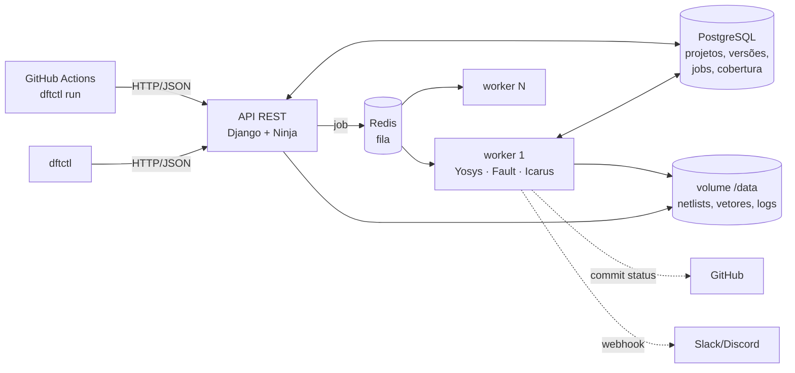

# DFT as Code — back-end

Pipeline de CI para Design for Test. A cada nova versão do RTL, ele roda síntese, inserção de scan chain, inserção de JTAG, ATPG e simulação de falhas, guarda a cobertura de falhas por versão e reprova o commit quando a testabilidade piora.

TCC de João Pedro (trilha DFT do CI Expert + pós em Desenvolvimento Back-end).



## O que o pipeline faz

Cada job executa estas etapas (o equivalente, no worker, ao `etapa1/dft/run_flow.sh`), cada uma com log, duração e status próprios:

| # | Etapa | Ferramenta | Saída |
|---|---|---|---|
| 1 | `synth` | `fault synth` (Yosys → osu035) | `<top>.nl.v` |
| 2 | `cut` | `fault cut` | `<top>.cut.v` (FFs viram entradas e saídas) |
| 3 | `atpg` | `fault atpg` (PRNG) | `<top>.tv.json`, `<top>.prng.coverage.yml` |
| 4 | `nl2bench` | `nl2bench` | `<top>.bench` (só se usar Quaigh) |
| 5 | `quaigh` | `fault atpg -g Quaigh` | ATPG determinístico (principal ou comparação) |
| 6 | `chain` | `fault chain` | `<top>.chained.v`, verificada por simulação |
| 7 | `asm` | `fault asm` | `<top>.tv.bin`, `<top>.au.bin` |
| 8 | `tap` | `fault tap` | `<top>.jtag.v`, vetores aplicados pela TAP e conferidos |
| 9 | `area` | `yosys stat -liberty` | área (µm²) e células de cada netlist |

Depois, o **detector de regressão** compara com a baseline e decide: `passed`, `failed` (regressão ou abaixo do alvo) ou `error` (o fluxo quebrou).

### Resultados conferidos neste código

Rodados pelo pipeline (fila + worker + API), em Ubuntu 24.04 com Yosys 0.33, Fault 0.9.4, Icarus 12.0 e Quaigh 0.0.6:

| Circuito | Sites | Falhas | Cobertura PRNG | Vetores | Quaigh | Scan | Área final (µm²) | Tempo |
|---|---|---|---|---|---|---|---|---|
| s27 | 45 | 90 | 86,67% | 6–7 | 86,67% | 8 | 57.880 | 10 s |
| s298 | 244 | 488 | 100% | 13–15 | 100% | 23 | 73.604 | 16 s |
| s344 | 346 | 692 | 100% | 12 | 100% | 35 | 89.364 | 41 s |
| s386 | 349 | 698 | 100% | 21 | 100% | 20 | 77.732 | 209 s |
| c17 | 25 | 50 | 100% | 4 | 100% | — | 572 | 4 s |
| c432 | 346 | 692 | 100% | 17 | 100% | — | 9.240 | 73 s |
| MAC 8 bits | 1434 | — | 100% | 1350 → 23 | — | 17 + 35 = 52 | 69.872 → 111.364 → 159.188 | ~5 min |

O s27 e o MAC batem exatamente com a etapa 1 (cobertura, vetores, cadeia e área). O MAC foi conferido com um RTL escrito a partir da especificação da etapa 1, não com o `rtl/mac8.v` original.

## Subir com Docker

```bash
cp .env.example .env              # troque senhas; defina DFT_API_TOKENS
docker compose up -d --build
docker compose exec api python manage.py createsuperuser
```

- API e documentação interativa (Swagger): http://localhost:8000/api/v1/docs
- Admin (projetos, jobs, etapas, artefatos): http://localhost:8000/admin
- Mais workers, para medir throughput: `docker compose up -d --scale worker=4`

A imagem do worker usa **Ubuntu 24.04** de propósito: o Yosys 0.33 dela reproduz os números da etapa 1. No Ubuntu 26.04, o Yosys 0.52 gera uma netlist um pouco diferente (MAC: 99,9% em vez de 100%). O Quaigh é compilado na imagem; use `WITH_QUAIGH=0` para um build mais rápido sem ele.

## Rodar sem Docker (WSL/Linux)

```bash
sudo apt install yosys iverilog redis-server
uv venv --python 3.13 .venv && source .venv/bin/activate
uv pip install -r requirements-dev.txt fault-dft==0.9.4 -e ./cli
cargo install quaigh --version 0.0.6        # opcional

python manage.py migrate
celery -A dft_backend worker -l info -c 1 -Q dft &     # 1 job por processo
python manage.py runserver
```

Sem `DATABASE_URL`, o back-end usa SQLite; sem `DFT_DATA_DIR`, usa `./data`. Outras variáveis: [`.env.example`](.env.example).

> O `venv/` que já existia nesta pasta é de Windows (Python 3.11) e não serve para o worker, que precisa de Linux e Python 3.13. Para a API pura no Windows, `pip install -r requirements.txt` nele funciona. O fluxo DFT, porém, precisa de WSL ou Docker.

## Uso

### Com o `dftctl`

```bash
pip install ./cli                         # ou: pip install "dftctl @ git+https://github.com/<dono>/<repo>#subdirectory=cli"
export DFT_API_URL=http://localhost:8000 DFT_API_TOKEN=...

cd examples/s27
dftctl validate                           # confere o dft.yaml
dftctl run                                # empacota os sources, envia, espera e mostra o veredito
dftctl history iscas89-s27                # cobertura por versão
dftctl artifacts <job> -d out/            # baixa netlists, vetores, cobertura e logs
dftctl logs <job> atpg
dftctl retry <job>                        # mesma entrada de novo (reprodutibilidade)
dftctl metrics                            # métricas de avaliação
```

Os códigos de saída de `dftctl run` são: `0` aprovado, `1` reprovado, `2` erro no fluxo, `3` timeout/cancelado, `4` erro de uso ou de rede. O commit, o branch e a mensagem saem do `git` local ou das variáveis `GITHUB_*`.

Exemplo real (o s27 com um registrador a mais na saída `G17`):

```
❌  iscas89-s27 @ ccccccc3  [main]  status: FAILED
   cobertura (prng): 83.67%  (82/98 falhas stuck-at, 49 sites)
   vetores: 87 → 7 após compactação
   scan chain: 4 FFs + 5 boundary = 9 (verificada)
   área: 4032 → 11176 → 58904 µm²  (synth → scan → scan_jtag)
   ✖ cobertura 83.67% abaixo do alvo de 85.00%
   ✖ cobertura caiu 2.99 p.p. (86.67% → 83.67%), acima do limite de 0.50 p.p.
```

### No GitHub Actions

Copie [`ci-template/dft.yml`](ci-template/dft.yml) para `.github/workflows/dft.yml` no **repositório do RTL** e configure `secrets.DFT_API_URL`, `secrets.DFT_API_TOKEN` e `vars.DFT_BACKEND_REPO`. Cada push ou PR que mexer no RTL roda o fluxo. O check fica vermelho quando há regressão, e o resumo com cobertura, vetores, scan e área aparece na aba *Summary*.

Há duas formas de o resultado chegar ao GitHub, e dá para usar as duas:

1. **Workflow + `dftctl`:** o próprio job do Actions passa ou falha.
2. **Commit status:** com `DFT_GITHUB_TOKEN` definido e o projeto com `repo_url` do GitHub, o worker publica `pending`, `success`, `failure` ou `error` no commit (contexto `dft-as-code/coverage`). Funciona também para jobs enviados fora do Actions.

O runner do GitHub precisa alcançar a API. Se ela roda só na sua máquina, use um runner self-hosted ou um túnel (cloudflared, ngrok, Tailscale Funnel).

### Pela API diretamente

```bash
# upload (multipart): arquivos avulsos em `files` ou um .tar.gz/.zip em `archive`
curl -X POST localhost:8000/api/v1/jobs -H "Authorization: Bearer $TOKEN" \
  -F dft_yaml_file=@dft.yaml -F files=@s27.v -F commit_sha=abc1234 -F branch=main

# a partir de um commit (o worker clona; dft.yaml do corpo ou do repositório)
curl -X POST localhost:8000/api/v1/jobs/git -H "Authorization: Bearer $TOKEN" \
  -H 'Content-Type: application/json' \
  -d '{"repo_url":"https://github.com/joao/tcc-dft","commit_sha":"abc1234...","branch":"main","project":"mac8"}'
```

| Método | Rota | Para quê |
|---|---|---|
| GET | `/api/v1/health` | banco e fila (público) |
| POST | `/api/v1/validate` | valida um dft.yaml |
| POST | `/api/v1/jobs` | cria job por upload |
| POST | `/api/v1/jobs/git` | cria job por commit |
| GET | `/api/v1/jobs?project=&status=&branch=&commit=` | lista jobs |
| GET | `/api/v1/jobs/{id}` | status e etapas |
| GET | `/api/v1/jobs/{id}/report` | relatório completo em JSON |
| GET | `/api/v1/jobs/{id}/logs/{etapa}` | log de uma etapa |
| GET | `/api/v1/jobs/{id}/artifacts[/{nome}]` | lista e baixa artefatos |
| POST | `/api/v1/jobs/{id}/cancel` · `/retry` | cancela ou repete |
| GET/POST/PATCH | `/api/v1/projects[/{nome}]` | projetos (criados também no primeiro job) |
| GET | `/api/v1/projects/{nome}/history?branch=` | cobertura por versão |
| GET | `/api/v1/metrics?project=&since_hours=` | métricas de avaliação |

O formato completo do `dft.yaml` está em [`docs/dft-yaml.md`](docs/dft-yaml.md).

## Detector de regressão

| Verificação | Efeito | Regra |
|---|---|---|
| `coverage_drop` | reprova | queda maior que `regression.max_drop_pp` p.p. em relação à baseline |
| `coverage_target` | reprova | cobertura menor que `coverage.target` |
| `vector_increase` | alerta | vetores cresceram mais que `warn_vector_increase_pct` % |
| `area_increase` | alerta | área final cresceu mais que `warn_area_increase_pct` % |
| `new_undetected` | informativo | falhas não detectadas que não estavam na baseline |

A **baseline** padrão é o último job *aprovado* do mesmo branch; se não houver, o do branch padrão (um PR é comparado com `main`). Comparar com o último aprovado, e não com o anterior, evita a "catraca": várias quedas de 0,4 p.p. seguidas, cada uma abaixo do limite, não se acumulam sem ninguém ver.

`new_undetected` é só informativo porque os nomes das células (`_18_`, `_19_`…) mudam a cada síntese.

## Métricas para a avaliação

`GET /api/v1/metrics` (ou `dftctl metrics`) calcula:

- **tempo de execução**, total e por etapa (média, mediana, p95);
- **tempo de fila** e **tempo para detectar uma regressão** (do envio ao veredito);
- **throughput**: jobs/hora e workers distintos na janela;
- **reprodutibilidade** em dois níveis: métricas iguais (cobertura, nº de vetores, área) e conjunto de vetores igual, entre jobs com a mesma entrada (hash de fontes + dft.yaml);
- **regressões detectadas**.

`python manage.py export_metrics -o jobs.csv` exporta um job por linha (cobertura, vetores, área de cada estágio, tempo de cada etapa) para as tabelas e gráficos do TCC. [`scripts/submit_benchmarks.py`](scripts/submit_benchmarks.py) envia um lote de ISCAS'85/'89 detectando top, clock, reset e VDD/GND, espera e imprime a tabela comparável com a literatura:

```bash
git clone --depth 1 https://github.com/AUCOHL/Fault /tmp/Fault
python scripts/submit_benchmarks.py /tmp/Fault/Benchmarks/ISCAS_89/s{27,298,344,386}.v --quaigh --wait --csv iscas89.csv
```

Os benchmarks ITC'99 não estão no repositório do Fault (os originais são em VHDL). Para usá-los, é preciso arranjar versões em Verilog e passá-las ao mesmo script.

## Achados para discutir no TCC

1. **O PRNG do Fault não é reprodutível no nível dos vetores.** Com a mesma semente e a mesma entrada, duas execuções dão a mesma cobertura, mas conjuntos de vetores diferentes depois da compactação, e às vezes outro número de vetores (s27: 6 ou 7; s298: 13 a 15). O Quaigh deu vetores idênticos bit a bit. Por isso a métrica de reprodutibilidade tem dois níveis, e a assinatura `result_fingerprint` não inclui o conteúdo dos vetores. Também por isso a regressão de *vetores* é só um alerta.
2. **Cobertura bruta × cobertura sobre falhas testáveis.** As 12 falhas não detectadas do s27 estão nos três inversores do reset (`_08_`, `_18_`, `_19_`), que não são testáveis por stuck-at no modelo "cut". O relatório lista as falhas não detectadas (`coverage.undetected`) para essa análise.
3. **Contornos do Fault 0.9.4 implementados no pipeline:**
   - `FAULT_THREADS=1` por padrão (evita o "Illegal instruction"). Escale com mais containers, não com mais threads.
   - Circuito combinacional: o `fault atpg` exige clock, então o pipeline injeta `__dft_clk` na netlist cortada.
   - Sequencial sem reset: o `fault chain` procura uma porta `rst`, então o pipeline injeta `__dft_rst` na netlist sintetizada.
   - `nl2bench` recebe só clock e reset em `-b`. Remover do `.bench` uma entrada que alimenta lógica faz o Quaigh abortar.
   - `atpg.min_coverage: 0` é rejeitado na validação.
   - Nomes escapados (`\_21_.d`) nas listas de não cobertas são duplicatas e ficam fora do relatório.
4. **Limitação:** o `fault tap` não aplica vetores pela JTAG quando uma *entrada funcional* está em `bypass`. Use `bypass` só para alimentação (VDD/GND).

## Testes

```bash
python -m pytest -v
```

São 41 testes: `dft.yaml`, parsers (com saídas reais do Fault), detector de regressão, extração segura de arquivos, API + fila + worker com um runner falso (aprovação, regressão, baseline, PR contra `main`, erro, cancelamento, retry, autenticação, GitHub status, webhook, CSV) e **integração com as ferramentas reais** (s27 completo com os números da etapa 1, c17 combinacional, sequencial sem reset). Os de integração são pulados se `fault`, `yosys` e `iverilog` não estiverem no PATH. O workflow [`.github/workflows/ci.yml`](.github/workflows/ci.yml) roda tudo no Ubuntu 24.04.

## Estrutura

```
dft_backend/          settings (por variável de ambiente), urls, celery
jobs/
  models.py           Project, Version, Job, JobStep, CoverageResult, Artifact
  dftconfig.py        schema e validação do dft.yaml
  api.py, schemas.py  API REST (Django Ninja)
  services.py         criação de jobs, baseline, relatório, histórico
  tasks.py            task do Celery que o worker executa
  regression.py       detector de regressão (função pura)
  notify.py           commit status no GitHub e webhook
  storage.py          disco compartilhado, extração segura, hash de entrada, git
  flow/runner.py      executor do fluxo (não depende do Django)
  flow/parsers.py     cobertura, logs do Fault, área do Yosys
  management/commands/export_metrics.py
  tests/
cli/dftctl/           cliente de linha de comando (só depende de PyYAML)
ci-template/dft.yml   workflow para o repositório do RTL
scripts/              envio de benchmarks em lote
tech/osu035/          biblioteca OSU 0.35 µm (do repositório do Fault, Apache-2.0)
examples/             s27 (ISCAS'89) e mac8
```

## Premissas a confirmar com o orientador

Validação só por simulação; ferramentas abertas no lugar das comerciais; o MAC basta como bloco próprio; o foco é o back-end; uma única scan chain (limite do Fault 0.9.4).
